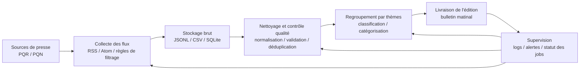

# Note de cadrage — La Gazette

## 1. Contexte et besoin

La Gazette est un service d’édition quotidienne qui synthétise le paysage de l’actualité régionale et nationale. Chaque matin, l’équipe doit repérer les sujets dominants dans la presse, identifier les sources qui en parlent, puis livrer une édition courte sous forme de résumé thématique avec, pour chaque article, un titre, un extrait, un lien et une date.

Le besoin est donc limité à une veille de presse structurée et reproductible :

- collecter les flux publiés par les éditeurs,
- ne conserver qu’un titre, un extrait, un lien et une date,
- regrouper les articles par thème,
- livrer un bulletin lisible dès 7 h,
- respecter les conditions d’utilisation des éditeurs et les règles de protection des données.

La valeur ne réside ni dans un front end sophistiqué, ni dans un résumé généré par un LLM, ni dans la récupération du texte intégral. Le vrai enjeu est la fiabilité, la traçabilité et la conformité.

## 2. Périmètre fonctionnel

### Ce qui est inclus

- lecture des flux RSS/Atom de presse régionale et nationale,
- collecte quotidienne des articles publiés dans les 24 dernières heures,
- stockage des données brutes de manière exploitable,
- nettoyage des entrées et contrôle de qualité,
- regroupement par thèmes (politique, économie, société, sport, culture, etc.),
- génération d’une édition matinale orientée vers un bulletin de synthèse,
- supervision de la chaîne de traitement (logs, alertes, statut des jobs).

### Ce qui n’est pas inclus

- scraping du texte intégral des articles,
- collecte de commentaires ou de profils d’utilisateurs,
- traitement d’images ou de visuels,
- création d’un site d’actualité riche,
- utilisation d’un modèle génératif pour résumer les articles,
- stockage de données personnelles ou de contenu sensible.

## 3. Contraintes importantes

- publication prévue au plus tard à 7 h,
- les articles sont considérés valides pendant moins de 24 h,
- la collecte doit respecter les conditions des éditeurs et le cadre légal du droit d’auteur,
- aucune donnée personnelle ne doit être gardée (pas de commentaires, pas de fiches de lecteur, pas d’identifiants),
- budget zéro au départ ; l’infrastructure de production sera ajoutée plus tard,
- le système doit être reproductible et observable, même en cas de panne ou de flux incomplets.

## 4. Stack technique retenue

Nous retenons une architecture simple, robuste et directement compatible avec le module :

- Python 3 pour la collecte, le nettoyage et la logique métier,
- Docker pour l’isolation de l’environnement de développement et des services,
- flux RSS/Atom comme source de vérité pour la collecte, car ils sont lisibles par machine, légers et faciles à exploiter,
- SQLite comme stockage local initial pour une base de données simple et immédiate,
- fichiers JSONL/CSV en mode brut pour conserver la matière sans transformation trop lourde,
- cron ou un orchestrateur léger pour l’exécution quotidienne,
- logs structurés et métriques simples pour la supervision.

### Pourquoi cette pile ?

- faible coût, sans dépendance d’infrastructure coûteuse,
- très adaptée à un système piloté par des flux d’actualité,
- simple à tester et à déboguer en équipe,
- facilement extensible vers PostgreSQL ou un orchestrateur plus avancé plus tard.

## 5. Alternatives écartées

### 1. Scraping HTML complet

Avantage : accès apparent à plus d’informations.

Limite : très coûteux en fiabilité, risqué pour le droit d’auteur, plus fragile face aux changements de structure, plus difficile à sécuriser et à maintenir.

Décision : écarté, car il sort du périmètre et augmente le risque juridique.

### 2. Utilisation directe d’API propriétaires sans filtrage

Avantage : données structurées, parfois plus complètes.

Limite : certains éditeurs ne proposent pas d’API publique ; les accès peuvent être limités, changeants ou payants. De plus, leur usage doit encore être conforme.

Décision : écarté comme source principale ; on privilégie les flux standardisés RSS/Atom, plus simples à surveiller.

### 3. Stack “big data” trop lourde

Avantage : très scalable.

Limite : trop complexe pour un premier cadrage et non nécessaire au niveau de l’objectif pédagogique.

Décision : écartée, car elle complique la mise en œuvre sans apporter de valeur immédiate.

## 6. Risques et points de vigilance

- variation de format entre éditeurs ; certains flux peuvent être incomplets ou mal formés,
- changement de structure de site ou de flux, ce qui casse la collecte sans alerte,
- risque de non-conformité juridique si on conserve trop de données ou récupère le texte complet,
- risque de duplication lorsque plusieurs sources traitent le même thème ou le même article,
- volumes faibles mais besoins de fiabilité et d’ordonnancement rigoureux,
- difficulté à qualifier les thèmes de façon stable sans heuristiques ou vocabulaire trop sensible.

## 7. Rôles dans l’équipe

Pour cette première itération, l’équipe peut se répartir comme suit :

- chef de projet / cadrage : valide le besoin, le périmètre, les risques et la cohérence de la stratégie,
- responsable collecte : identifie les sources, les flux et les règles d’accès,
- responsable données : gère le stockage brut, le nettoyage et le contrôle qualité,
- responsable architecture : décrit le pipeline et les flux entre les boîtes,
- responsable supervision : met en place les logs, les alertes et le suivi des jobs.

## 8. Architecture cible (six boîtes)

### Ce qui circule entre les boîtes

- un flux RSS/Atom source, avec ses métadonnées de publication,
- un article brut sous forme de titre, extrait, lien, date et source,
- une version normalisée avec uniformisation du format,
- des catégories de sujets et des regroupements thématiques,
- une édition quotidienne synthétique,
- des événements de supervision : succès, échec, absence de donnée, anomalies de format.

## 9. Conclusion

La Gazette ne doit pas chercher à reproduire la presse entière. Elle doit fournir une lecture synthétique, fiable et conforme de l’actualité quotidienne sur la base de sources maîtrisées. Le bon cadrage est donc avant tout un compromis entre simplicité, conformité juridique, robustesse et capacité à livrer une édition matinale exploitable.

Le TD 2 vise la base technique du pipeline ; le TD 3 vise la collecte et la validation des flux. C’est à cette étape que l’équipe pourra confirmer ou ajuster les choix de sources, les formats et la logique de stockage.
